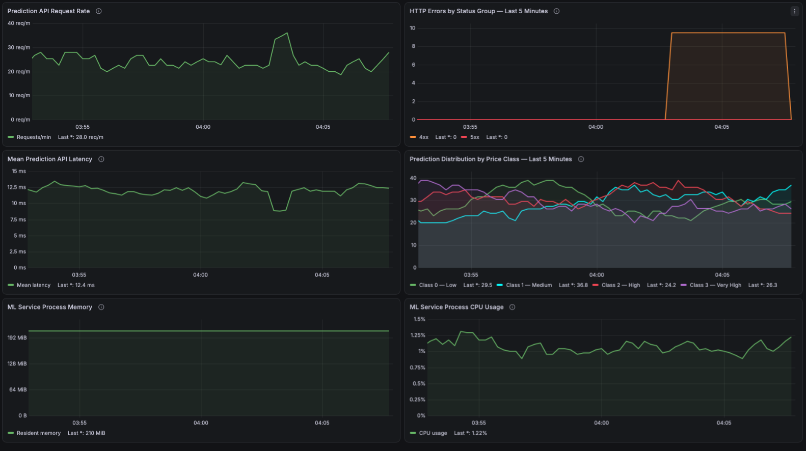

# Mobile Price Classification — исследование и сервис предсказаний

Exploratory Data Analysis (EDA) датасета **Mobile Price Classification** с Kaggle.  
Проект включает разведочный анализ данных (ЛР1), обучение и сравнение моделей с логированием в MLflow (ЛР2), а также REST API на FastAPI для определения ценовой категории телефона с запуском в Docker (ЛР3).

В ЛР4 проект дополнен генератором запросов, совместным запуском сервисов через Docker Compose и мониторингом через Prometheus и Grafana. [Запуск и результаты ЛР4](#лр4-docker-compose-и-мониторинг).

**Технологии проекта:** Python 3.12, pandas, NumPy, matplotlib, seaborn, Bokeh, scikit-learn, CatBoost, AutoFeat, Optuna, MLflow, FastAPI, Pydantic, Uvicorn, cloudpickle, HTTPX, Docker, Docker Compose, prometheus-client, prometheus-fastapi-instrumentator, Prometheus и Grafana.

## Установка и запуск

### 1. Клонирование репозитория

```bash
git clone <URL_РЕПОЗИТОРИЯ>
cd project_Komarevtsev
```

## Создание виртуального окружения

```bash
python -m venv .venv_project_Komarevtsev
source .venv_project_Komarevtsev/bin/activate  # Linux/Mac
# или
.venv_project_Komarevtsev\Scripts\activate     # Windows
```
## Установка зависимостей

```bash
pip install -r requirements.txt
```

## Размещение данных

Поместите файл train.csv в папку data/.
Датасет можно скачать с Kaggle:
 https://www.kaggle.com/datasets/iabhishekofficial/mobile-price-classification

## Описание датасета

Датасет содержит 2000 записей о мобильных телефонах: 20 входных признаков и целевой столбец price_range.
Категориальные признаки

blue, dual_sim, four_g, three_g, touch_screen, wifi — бинарные (0/1)
n_cores — количество ядер процессора (1-8)
Числовые признаки

battery_power — ёмкость батареи (mAh)
clock_speed — тактовая частота процессора (GHz)
fc — мегапиксели фронтальной камеры
int_memory — внутренняя память (GB)
m_dep — толщина телефона (cm)
mobile_wt — вес телефона (g)
pc — мегапиксели основной камеры
px_height, px_width — разрешение экрана (px)
ram — оперативная память (MB)
sc_h, sc_w — размеры экрана (cm)
talk_time — время разговора (часы)
Целевая переменная

price_range — ценовая категория: 0 (низкая), 1 (средняя), 2 (высокая), 3 (очень высокая)
Проведённый анализ

## Очистка данных

Оставлены строки, удовлетворяющие условиям: sc_w >= 4, sc_h >= 5, px_width >= 500, px_height >= 100. После фильтрации осталось 1152 объекта.
Оптимизированы типы данных (int8, int16, float32) для экономии памяти

## Feature Engineering

Созданы новые признаки:
total_pixels — общее разрешение экрана
pixel_density — отношение количества пикселей к площади экрана
battery_efficiency — эффективность батареи
total_camera — суммарная мощность камер

## Ключевые выводы

RAM — наиболее значимый признак (корреляция с ценой ~0.92)
Дорогие телефоны имеют больше RAM, ёмкую батарею, высокое разрешение экрана и мощные камеры
Простая линейная корреляция наличия 4G, Wi-Fi и сенсорного экрана с ценовой категорией близка к нулю.
Наблюдается корреляция между высотой и шириной разрешения экрана, а также между физическими размерами экрана.

# MLFlow

### Расположение скрипта
project_Komarevtsev/
└── mlflow/
    └── start_mlflow.sh    ← скрипт запуска

### Команда запуска 

1. Перейдите в папку mlflow
cd mlflow

2. Запустите скрипт
sh start_mlflow.sh

После запуска откройте браузер по адресу: http://127.0.0.1:5000

# Результаты обучение моделей 
### Лучшая модель 

В ходе исследования были проведены эксперименты с различными подходами к обработке признаков и моделям машинного обучения. Наибольший сохранённый F1 macro на отложенной части выборки показал CatBoostClassifier с экспертным отбором признаков. После сравнения финальный pipeline обучен на всей очищенной выборке. Приведённые ниже метрики относятся к исследовательскому разбиению, а не к независимой оценке финального pipeline.

CatBoost metrics:
   precision: 0.9345
   recall: 0.9343
   f1: 0.9343
   roc_auc: 0.9955


| Параметр | Значение |
|---|---|
| Алгоритм | `CatBoostClassifier` |
| iterations | `200` |
| depth | `6` |
| learning_rate | `0.1` |
| random_seed | `42` |
| catboost_version | `1.2.10` |
| mlflow_version | `2.16.0` |
| Размер модели | `543 199 байт (~530 КБ)` |

| № | Признак | Тип |
|---|---------|-----|
| 1 | `battery_power` | integer |
| 2 | `blue` | long |
| 3 | `clock_speed` | float |
| 4 | `dual_sim` | long |
| 5 | `fc` | integer |
| 6 | `four_g` | long |
| 7 | `int_memory` | integer |
| 8 | `m_dep` | float |
| 9 | `mobile_wt` | integer |
| 10 | `n_cores` | long |
| 11 | `pc` | integer |
| 12 | `px_height` | integer |
| 13 | `px_width` | integer |
| 14 | `ram` | integer |
| 15 | `sc_h` | integer |
| 16 | `sc_w` | integer |
| 17 | `talk_time` | integer |
| 18 | `three_g` | long |
| 19 | `touch_screen` | long |
| 20 | `wifi` | long |
| 21 | `total_pixels` | integer |
| 22 | `pixel_density` | double |
| 23 | `battery_efficiency` | float |
| 24 | `total_camera` | integer |


## Запуски MLflow

- Исследовательский CatBoost: `339fa3e1a0bb41d881b37f37d3aeb33a`.
- Финальный отдельный CatBoost из ЛР2: `9909675381a54e02ac66ab420f252038`.
- Полный pipeline для сервиса, указанный в `services/models/get_model.py`: `506f7bd7007d451fa1414639a4c88f93`.

Для работы API используется последний вариант: он содержит обученные преобразования, отбор признаков и классификатор. Отдельный CatBoost не заменяет полный pipeline.

## Сервис предсказаний

Сервис принимает 20 характеристик мобильного телефона и возвращает целочисленную ценовую категорию: `0` — низкая, `1` — средняя, `2` — высокая, `3` — очень высокая. Результат является категорией, а не стоимостью в рублях.

### Файлы сервиса

```text
services/
├── ml_service/
│   ├── main.py
│   ├── api_handler.py
│   ├── requirements.txt
│   └── Dockerfile
└── models/
    ├── get_model.py
    └── model.pkl
```

| Файл | Назначение |
|---|---|
| `ml_service/main.py` | FastAPI-приложение, схема `PhoneFeatures`, проверка запроса, маршруты GET `/` и POST `/api/prediction`. При запуске создаётся один обработчик модели. |
| `ml_service/api_handler.py` | Класс `FastAPIHandler`: загружает pipeline из `model.pkl`, рассчитывает четыре производных признака, вызывает модель и возвращает целый класс. |
| `ml_service/requirements.txt` | Зависимости сервиса с версиями для установки в Docker-образ. |
| `ml_service/Dockerfile` | Описание образа: Python 3.12, копирование кода, установка библиотек, каталог `/models`, порт 8000 и запуск Uvicorn. |
| `models/get_model.py` | Подключается к MLflow по адресу `http://127.0.0.1:5000`, загружает sklearn pipeline из `runs:/506f7bd7007d451fa1414639a4c88f93/model` и сохраняет его через `cloudpickle`. |
| `models/model.pkl` | Полный обученный pipeline для предсказаний. Файл создаётся скриптом экспорта и исключён из Git правилом `*.pkl`. |

Если используется `.dockerignore`, он находится рядом с Dockerfile и исключает из контекста сборки кэш Python и другие ненужные файлы.

### Подготовка модели

На машине разработки используется существующее виртуальное окружение. Из корня проекта установите зависимости проекта и сервиса:

```bash
source .venv_project_Komarevtsev/bin/activate
python -m pip install -r requirements.txt
python -m pip install -r services/ml_service/requirements.txt
```

Для повторного получения `model.pkl` сначала запустите MLflow в отдельном терминале из папки `mlflow`, как описано выше. База `mlruns.db` и соответствующие артефакты должны быть доступны. Затем из корня проекта выполните:

```bash
python services/models/get_model.py
```

Файл появится в `services/models/model.pkl`. В нём должен находиться полный sklearn pipeline, а не отдельный CatBoostClassifier. Для уже экспортированной модели работающий сервер MLflow не требуется.

### Сборка Docker-образа

Запустите Docker Desktop либо используйте работающий Docker Engine. Проверить доступность клиента и сервера можно командой `docker version`.

Из корня проекта перейдите в папку сервиса и соберите образ первой версии:

```bash
cd services/ml_service
docker build -t mobile-price-service:1 .
```

Точка задаёт текущую папку как контекст сборки. В Dockerfile используется `python:3.12-slim`, соответствующий основной версии Python окружения обучения. Зависимости устанавливаются из сервисного `requirements.txt`; локальное виртуальное окружение в образ не копируется.

Проверка наличия образа:

```bash
docker image ls mobile-price-service
```

В списке должны присутствовать имя `mobile-price-service` и тег `1`. При повторной сборке в рамках ЛР3 используется тот же тег.

### Запуск контейнера

Следующую команду выполняйте из `services/ml_service`. Убедитесь, что файл `../models/model.pkl` существует.

```bash
docker run --name mobile-price-service \
  -p 8001:8000 \
  -v "$(pwd)/../models:/models:ro" \
  mobile-price-service:1
```

- `--name` задаёт имя контейнера.
- `-p 8001:8000` связывает порт 8001 компьютера с портом 8000 контейнера.
- `-v` подключает соседнюю папку `models` к `/models` внутри контейнера.
- `:ro` разрешает только чтение подключённой папки.

Модель доступна приложению по пути `/models/model.pkl`. Uvicorn автоматически запускается командой из Dockerfile и слушает `0.0.0.0:8000` внутри контейнера. Браузер обращается к сервису через порт **8001** компьютера.

Команда показывает логи в текущем терминале. Для остановки нажмите `Ctrl+C`. В другом терминале можно использовать:

```bash
docker stop mobile-price-service
```

Для повторного запуска существующего остановленного контейнера:

```bash
docker start -ai mobile-price-service
```

Эта команда использует ранее созданный контейнер. После изменения кода, пересборки образа или установки новых зависимостей контейнер нужно пересоздать из нового образа.

### Проверка работоспособности

Документация Swagger: [http://localhost:8001/docs](http://localhost:8001/docs).

Проверка корневого маршрута:

```bash
curl http://localhost:8001/
```

Ожидаемый ответ с HTTP 200:

```json
{"Hello": "World"}
```

Для получения предсказания в Swagger раскройте **POST `/api/prediction`**, нажмите **Try it out**, задайте `item_id` равным `123` и вставьте приведённый ниже JSON в **Request body**. Затем нажмите **Execute**.

Адрес запроса:

```text
http://localhost:8001/api/prediction?item_id=123
```

Пример тела запроса:

```json
{
  "battery_power": 615,
  "blue": 1,
  "clock_speed": 2.5,
  "dual_sim": 0,
  "fc": 0,
  "four_g": 0,
  "int_memory": 10,
  "m_dep": 0.8,
  "mobile_wt": 131,
  "n_cores": 6,
  "pc": 9,
  "px_height": 1216,
  "px_width": 1786,
  "ram": 2769,
  "sc_h": 16,
  "sc_w": 8,
  "talk_time": 11,
  "three_g": 1,
  "touch_screen": 0,
  "wifi": 0
}
```

`item_id` передаётся в URL и не включается в признаки модели. Целевой столбец `price_range` в запрос не передаётся. Поля `total_pixels`, `pixel_density`, `battery_efficiency` и `total_camera` сервис рассчитывает самостоятельно.

Пример структуры успешного ответа:

```json
{
  "item_id": 123,
  "predict": 2
}
```

В разделе **Server response** должны быть HTTP 200, переданный `item_id` и целочисленный `predict` в диапазоне 0–3. Конкретный класс определяется загруженной моделью; `2` приведён как пример. При отсутствии обязательного поля, недопустимом бинарном значении или лишнем поле ожидается HTTP 422.

Для проверки согласованности предсказаний можно отправить одинаковый JSON в локальный сервис и контейнер с одним и тем же `model.pkl`. Локальный запуск из `services/ml_service` при активном окружении:

```bash
uvicorn main:app --reload
```

Локальный сервис доступен на `http://localhost:8000/docs`, контейнер — на `http://localhost:8001/docs`. Для одинаковых входных данных предсказания должны совпадать.

Если контейнер не отвечает или завершился, проверьте его состояние и логи:

```bash
docker ps -a --filter name=mobile-price-service
docker logs --tail 50 mobile-price-service
```

## Docker Compose и мониторинг

К API добавлены генератор запросов, сбор метрик Prometheus и дашборд Grafana. Сервис предсказаний обновлён до образа `mobile-price-service:2`. Разделы выше сохраняют описание и команды ЛР1–ЛР3; совместный запуск текущей системы описан ниже.

### Сервисы и адреса

| Сервис | Назначение | Веб-интерфейс |
|---|---|---|
| `ml_service` | Предсказания и экспорт метрик | [Swagger](http://localhost:8001/docs) · [Метрики](http://localhost:8001/metrics) |
| `requests` | Генерация телефонов и отправка POST-запросов со случайными паузами 0–5 секунд | Нет |
| `prometheus` | Сбор метрик API каждые 15 секунд и хранение истории | [Prometheus](http://localhost:9090) · [Targets](http://localhost:9090/targets) |
| `grafana` | Дашборд нагрузки, ошибок, ресурсов и распределения предсказаний | [Grafana](http://localhost:3000) |

PostgreSQL и pgAdmin не подключались: необязательный раздел с БД пропущен.

### Новые файлы и изменения

| Файл или папка | Содержимое |
|---|---|
| [services/compose.yml](services/compose.yml) | Запуск четырёх сервисов, порты, тома и проверка готовности API |
| [services/requests/requests.py](services/requests/requests.py) | Генератор характеристик телефонов и HTTP-запросов через HTTPX |
| [services/requests/Dockerfile](services/requests/Dockerfile) и [requirements.txt](services/requests/requirements.txt) | Образ генератора `mobile-price-requests:1` и его зависимости |
| [services/prometheus/prometheus.yml](services/prometheus/prometheus.yml) | Сбор метрик с `ml_service:8000/metrics` |
| `services/prometheus/screenshots/` | Скриншоты трёх графиков Prometheus |
| [services/grafana/mobile-price-dashboard.json](services/grafana/mobile-price-dashboard.json) | Переносимый экспорт дашборда: шесть панелей и десять PromQL-запросов |
| [services/grafana/Dashboard.png](services/grafana/Dashboard.png) | Скриншот дашборда |

В `services/ml_service/main.py` добавлены HTTP-метрики и гистограмма `mobile_price_prediction` с границами `0.5`, `1.5`, `2.5`, `3.5`. Зависимости мониторинга записаны в сервисный `requirements.txt`.

### Запуск через Docker Compose

Нужны работающий Docker Desktop и файл `services/models/model.pkl`, подготовленный  выше. Порты 8001, 9090 и 3000 должны быть свободны.

Из корня проекта:

```bash
cd services
docker compose up -d --build
docker compose ps
```

В [Targets Prometheus](http://localhost:9090/targets) цель `ml_service` должна иметь статус **UP**. Генератор запускается автоматически после готовности API.

Команды из папки `services`:

```bash
docker compose logs --tail 20 requests     # Последние ответы генератора
docker compose logs --tail 50 ml_service   # Логи API
docker compose stop                       # Остановить контейнеры
docker compose up -d                       # Запустить снова
docker compose down                       # Удалить контейнеры, сохранив тома
```

Модель подключена к `/models` только для чтения. История Prometheus хранится в томе `prometheus_data`, настройки Grafana — в `grafana_data`. Команда `docker compose down -v` удаляет эти тома вместе с данными.

### Подключение и восстановление дашборда Grafana

1. Откройте [Grafana](http://localhost:3000). Начальные данные входа — `admin / admin`; если пароль изменён, используйте свой.
2. В **Connections → Add new connection** добавьте источник **Prometheus** с адресом `http://prometheus:9090` и нажмите **Save & test**.
3. В **Dashboards → New → Import dashboard** загрузите `services/grafana/mobile-price-dashboard.json` и выберите созданный источник Prometheus.

Внутри Compose контейнеры обращаются друг к другу по имени сервиса: Grafana использует `prometheus:9090`, генератор — `ml_service:8000`.

### Дашборд Grafana



Дашборд показывает последние 15 минут и обновляется каждые 15 секунд.

| График | Что показывает | Уровень мониторинга |
|---|---|---|
| Prediction API Request Rate | Частота POST-запросов к API, запросов в минуту | Прикладной |
| HTTP Errors by Status Group — Last 5 Minutes | Число ответов `4xx` и `5xx` за скользящие 5 минут | Прикладной |
| Mean Prediction API Latency | Среднее время обработки запроса к API, миллисекунды | Прикладной |
| ML Service Process Memory | Резидентная память Python-процесса API | Инфраструктурный |
| ML Service Process CPU Usage | Использование CPU процессом API относительно одного логического CPU | Инфраструктурный |
| Prediction Distribution by Price Class — Last 5 Minutes | Число предсказаний каждого класса за скользящие 5 минут | Поведение модели |

Распределение ответов помогает замечать изменения поведения модели, но не измеряет accuracy/F1 и само по себе не доказывает сдвиг данных. Для оценки точности нужны правильные ответы. Значения `increase()` могут быть дробными из-за расчёта прироста счётчиков на границах временного окна.

Для проверки ошибок отправьте запрос без обязательных признаков — API вернёт **422**:

```bash
curl -i -X POST "http://localhost:8001/api/prediction?item_id=999" \
  -H "Content-Type: application/json" \
  -d '{}'
```

### Графики Prometheus

<details>
<summary>Посмотреть три графика</summary>

**Prediction Distribution by Price Class.** Число предсказаний каждого класса за предыдущие 5 минут. Отдельные классы получены вычитанием соседних накопительных корзин гистограммы.


**Prediction API Request Rate.** Частота запросов к endpoint-у предсказаний, запросов в минуту.


**HTTP Errors by Status Group.** Число ответов `4xx` и `5xx` за скользящие 5 минут.


</details>
